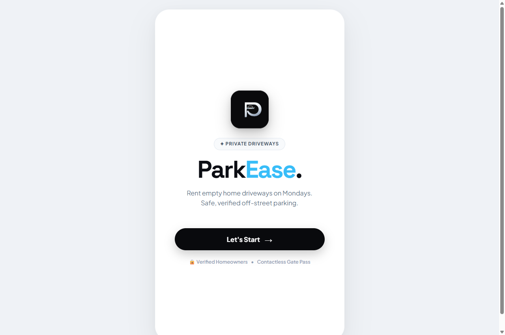
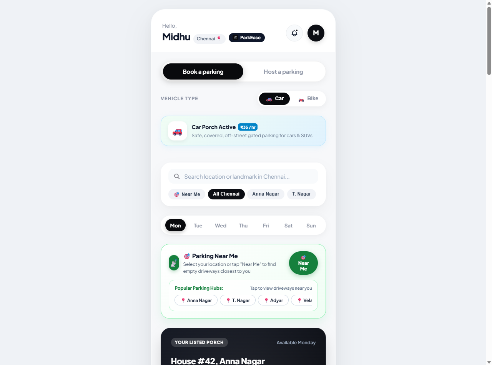
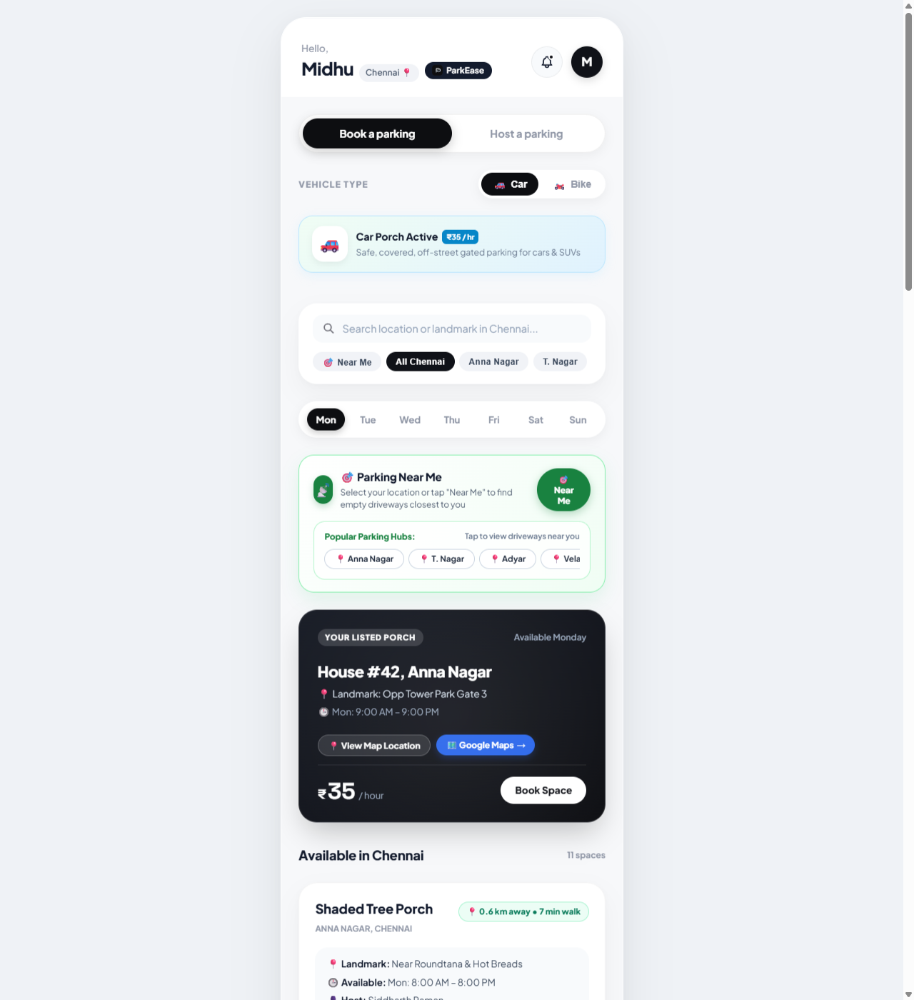

# 🚗 4 PARK - Community Driveway & Private Parking Sharing Platform

Built with **Kotlin (Ktor)** & a modern web interface.

> **Scenario Solved**:  
> *"In my house one car parking is there, and on Monday from 9:00 AM to 9:00 PM my vehicle won't be there, so I planned to give my parking for rent so society people don't want to park on the road, they can park in my home for rent."*

## 📸 Screenshots

| Welcome Screen | Dashboard & Vehicle Toggle | Driveways & Booking |
| :---: | :---: | :---: |
|  |  |  |

---

## 🌟 Key Features

1. **Two Core Options**:
   - 🚗 **Book a Parking**: Browse available neighborhood driveways, filter by vehicle type and day, and reserve with instant gate clearance.
   - 🏡 **Host a Parking**: Directly list your empty driveway or porch during hours your vehicle is away (e.g. Monday 9:00 AM – 9:00 PM).

2. **Vehicle Type Selection (Car / Bike)**:
   - **Car**: Dedicated car parking rates (e.g. ₹35 / hr).
   - **Bike**: Two-wheeler parking rates (e.g. ₹15 / hr).
   - Hosts can choose to accept Car only, Bike only, or Both!

3. **Sky Blue Minimalist Experience**:
   - **Page 1**: Clean, centered welcome screen with bold **`4 PARK`** title and glowing **`Let's Start`** button.
   - **Page 2**: Displays available spaces with prominent **Available Time** and **Hourly Rate**.

3. **Collision & Overlap Prevention Engine (Kotlin)**
   - Guarantees zero double-booking by mathematically verifying time boundaries:
     $$\max(\text{reqStart}, \text{bookStart}) < \min(\text{reqEnd}, \text{bookEnd})$$
   - Rejects bookings outside your 9:00 AM – 9:00 PM availability window so your driveway is strictly empty before your car returns!

4. **Digital Gate Pass & Security Guard QR Code**
   - Once booked, renter receives a **Verified Resident Gate Pass** with code `4PARK-PASS-XXXX`.
   - Society gate guards can scan the QR code to verify guest authorization without calling the host.
   - Live check-in and check-out tracking ("Parked inside porch" vs "Porch cleared").

5. **Interactive Society Map**
   - Visual 2D neighborhood layout showing open driveways, rented spots, and owner-occupied houses.

---

## 🛠️ Tech Stack & Directory Layout

- **Backend**: Kotlin 1.9.24 / 2.0 with **Ktor 2.3.12** (Netty server, Content Negotiation, Kotlinx.serialization, CORS, Routing).
- **Frontend**: **4 PARK** Web UI (HTML5, Vanilla CSS3 with Glassmorphism, Responsive Design, and JavaScript).
- **Tests**: Kotlin Test suite verifying conflict detection and pricing.

```
4park/
├── build.gradle.kts                # Gradle build & Ktor dependencies
├── settings.gradle.kts             # Project definition
├── index.html                      # Direct browser launcher
├── README.md                       # Documentation
├── src/
│   ├── main/
│   │   ├── kotlin/com/fourpark/
│   │   │   ├── Application.kt      # Ktor server entry point (port 8080)
│   │   │   ├── models/
│   │   │   │   └── Models.kt       # ParkingSpot, Booking, Schedule, DTOs
│   │   │   ├── routes/
│   │   │   │   └── ApiRoutes.kt    # /api/spots, /api/bookings, /api/host
│   │   │   └── services/
│   │   │       └── ParkingService.kt # Concurrency-safe store & validation logic
│   │   └── resources/
│   │       ├── logback.xml         # Logging config
│   │       └── static/             # Frontend served by Ktor
│   │           ├── index.html      # 4 PARK Single Page App
│   │           ├── styles.css      # Modern Glassmorphic stylesheet
│   │           └── app.js          # API client & UI engine
│   └── test/kotlin/com/fourpark/
│       └── ParkingServiceTest.kt   # Unit tests for conflict detection
```

---

## 🚀 How to Run the Project

### Option 1: Open Instantly in Your Browser
You can immediately preview and interact with the **4 PARK** web interface by opening:
`C:\Users\midhu\.gemini\antigravity-ide\scratch\4park\index.html` in Chrome, Edge, or Firefox.
The client automatically operates in interactive mode with full booking, pass generation, and search capabilities!

### Option 2: Run via Kotlin Ktor Backend
If you have Gradle/JDK installed:
```bash
cd C:\Users\midhu\.gemini\antigravity-ide\scratch\4park
gradle run
```
Or open the folder in **IntelliJ IDEA / Android Studio / Antigravity IDE** and click **Run** on `com.fourpark.ApplicationKt`.

The server will launch at:
```
http://localhost:8080
```
- Frontend: `http://localhost:8080/`
- API Spots: `http://localhost:8080/api/spots`
- API Bookings: `http://localhost:8080/api/bookings`
- Host Dashboard: `http://localhost:8080/api/host/dashboard`

---

## 📡 REST API Reference

| Method | Path | Description |
|---|---|---|
| `GET` | `/api/spots?day=MONDAY` | Fetch driveways open on given day |
| `GET` | `/api/spots/{id}` | Get spot details and schedules |
| `POST` | `/api/spots` | Host registers a new driveway |
| `GET` | `/api/spots/{id}/availability` | Verify if slot is free |
| `GET` | `/api/bookings` | List active bookings and passes |
| `POST` | `/api/bookings` | Reserve a time slot (with collision check) |
| `POST` | `/api/bookings/{id}/checkin` | Renter marks vehicle parked |
| `POST` | `/api/bookings/{id}/checkout` | Renter clears driveway |
| `GET` | `/api/host/dashboard` | Host earnings & upcoming reservation stats |
